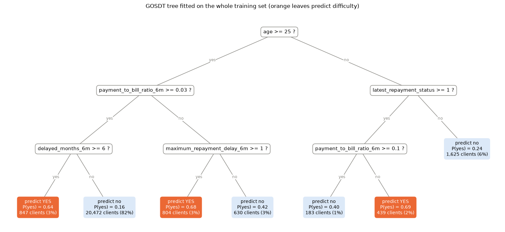
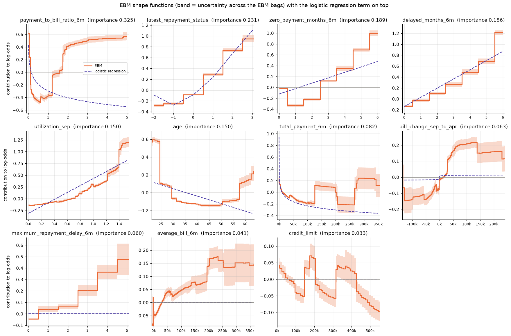
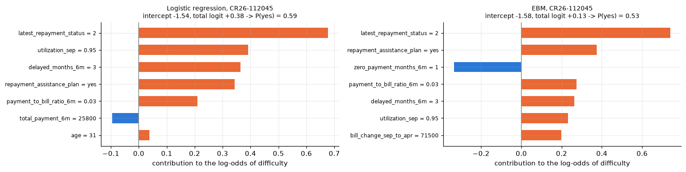
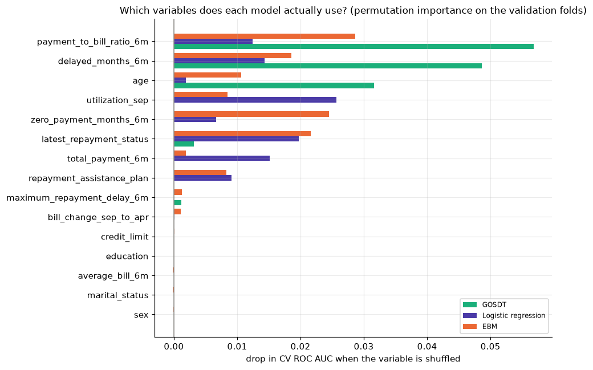

<p align="center">
  
</p>

<p align="center">
  <a href="https://colab.research.google.com/github/ikerosales/glassbox-credit-risk/blob/main/XAI_Phase1_logical_models.ipynb"></a>
  &nbsp;
  <a href="https://colab.research.google.com/github/ikerosales/glassbox-credit-risk/blob/main/XAI_Phase2.ipynb"></a>
  <br>
  <sub>Part 1: logical models &nbsp;·&nbsp; Part 2: tree vs logistic regression vs EBM</sub>
</p>

# glassbox-credit-risk

Predicting whether a credit card client will have trouble paying next month is the easy part to describe. What we actually wanted to find out is **what a model learns when it does that**, why it flags one specific client and not another, and what happens when two models that are equally accurate give *different reasons* for the same decision.

So instead of chasing the last decimal of accuracy with a black box, we fitted three families of models that can be read directly (an optimal sparse decision tree, a lasso logistic regression and an Explainable Boosting Machine), interpreted each of them globally and on the same individual clients, and put their explanations side by side to see where they agree and where they contradict each other.

## Key findings

- **The signal is narrow.** The best model reaches **0.819 accuracy against 0.788** for always predicting "no". Almost everything it knows comes from repayment behaviour: how many months the client was late, whether they are late right now, and how much of the bill they pay. Bills, credit limit and demographics (sex included) add little or nothing.
- **Interpretability is almost free here.** A **7-leaf tree** gets 0.8154, a 100-tree gradient boosting black box 0.8164, and the EBM beats the black box (0.8188, AUC 0.776) while staying fully readable.
- **The three models tell the same story at different resolutions.** The tree summarises it in three profiles that fit in one sentence each, the logistic regression in 12 odds ratios, the EBM in one curve per variable.
- **Different learners found the same thresholds independently.** Age 25, being late in *all six* months, and a payment ratio around 1.75 show up both as splits of the trees and as jumps in the EBM curves.
- **A straight line can get things backwards.** Clients paying more than 1.75 times their bill are as risky as clients paying 1% (usually a big catch-up payment on old debt). The EBM sees it; the logistic regression calls them its *safest* clients.
- **Same client, same fact, opposite sign.** For one client, "two months without paying" pushes the risk *up* in the logistic regression and *down* in the EBM, only because one model forces that variable to be linear.
- **Some positives are simply not predictable.** A client who never missed a payment and paid 101% of the bill, but still ended up in difficulty, looks exactly like the best clients to all three models.

## The data

The dataset comes from the classic **[Default of Credit Card Clients](https://archive.ics.uci.edu/dataset/350/default+of+credit+card+clients)** dataset (Yeh & Lien, 2009, UCI Machine Learning Repository): 30,000 credit card holders of a Taiwanese bank, with their monthly repayment status, bills and payments between April and September 2005. Amounts are in New Taiwan dollars (NTD).

We work with a **semi-synthetic version** built for studying interpretation. Instead of the raw monthly columns, each client is described by 15 six-month summaries, and the target, `payment_difficulty_next_month`, is semi-synthetic. That makes it a good playground for comparing explanations, and a bad source of conclusions about real lending (the data dictionary is explicit about it, and so are we).

| | |
|:--|:--|
| `train.csv` | 25,000 labelled clients, **21.2% with difficulty** (so the baseline to beat is 78.8% accuracy) |
| `test.csv` | 5,000 unlabelled clients |
| `data-dictionary.xlsx` | definition, units and cautions for every variable, plus the observation timeline |

<details>
<summary><b>The 15 predictors</b></summary>

| Variable | What it is |
|:--|:--|
| `credit_limit` | Credit limit (NTD) |
| `sex`, `education`, `marital_status`, `age` | Recorded demographics. `sex` is kept mainly as an audit attribute |
| `latest_repayment_status` | Most recent status code. Positive values are months of delay; -2, -1 and 0 are not documented in the source, so we never give them a meaning |
| `maximum_repayment_delay_6m` | Longest delay in the last six months |
| `delayed_months_6m` | How many of the six months had a delay (0 to 6) |
| `average_bill_6m` | Average bill. Can be negative (credit in favour of the client) |
| `bill_change_sep_to_apr` | September bill minus April bill |
| `total_payment_6m` | Total paid over the six months |
| `payment_to_bill_ratio_6m` | Total paid / sum of positive bills, capped at 5. Very large values usually mean a big catch-up payment or a tiny bill |
| `zero_payment_months_6m` | Months with a recorded payment of zero (0 to 6) |
| `utilization_sep` | September bill / credit limit, clipped to [0, 2] |
| `repayment_assistance_plan` | Whether the lender put the client on a support plan before the outcome month. It is offered to clients already showing stress, so a positive association is **selection, not an effect of the plan** |

</details>

## How we approached it

**One evaluation protocol for everything.** Every decision (hyperparameters, model comparison, feature transformations, classification threshold) is made with the same stratified 5-fold split of the training set. We report accuracy, ROC AUC, balanced accuracy, recall and F1, because with 21% positives accuracy alone is misleading.

**One rule to pick model size.** For every model we keep **the smallest configuration whose CV accuracy is within 0.002 of the best one** (roughly one standard deviation across folds). Extra leaves or coefficients that don't buy accuracy only cost readability.

### Part 1: which logical model?

We started with rule-based models only and compared five learners under that protocol, plus a black box as a reference:

| Model | Size | CV accuracy | CV AUC |
|:--|:--|:--|:--|
| CART (`max_depth=4`, `min_samples_leaf=200`) | 14 leaves | 0.8133 | 0.747 |
| **GOSDT** (`depth_budget=4`, `regularization=0.0005`) | **7 leaves** | **0.8154** | 0.649 |
| Greedy rule list | 7 rules + else | 0.7879 | 0.719 |
| Bayesian rule list | 13 rules | 0.8053 | 0.744 |
| RIPPER (`max_rules=8`, `max_rule_conds=3`) | 8 rules + default | 0.8043 | 0.588 |
| GOSDT with threshold guessing | 7 leaves | 0.8136 | 0.652 |
| *Gradient boosting (black box, reference only)* | *100 trees* | *0.8164* | *0.768* |

A few of these failed in instructive ways. The **greedy rule list** never predicts "yes": its first rule groups every currently late client together at 44%, removes them, and can never go back to separate the really risky ones inside that group. The **Bayesian rule list** works, but its 13 rules only make sense read in order, and after five or six of them it is hard to say who is left. **RIPPER** writes very precise rules (58% to 96%) that together cover only 7% of the clients.

**GOSDT**, which searches for the *optimal* tree under a penalty per leaf instead of growing it greedily, won on both accuracy and size. Letting a boosting model propose the thresholds inside each fold (threshold guessing) rebuilt practically the same tree, so the hand-picked cut points were not an artefact of looking at the data.

### Part 2: three families, same clients

Then we fitted the three families, each with the preprocessing its form needs, all inside the CV folds:

| Family | What it needs | What we did |
|:--|:--|:--|
| **GOSDT** tree | binary features | 25 `feature >= threshold` indicators, placed where the difficulty rate jumps in the EDA |
| **Lasso logistic regression** | a roughly linear relation with the log-odds | status as categories (code 0 as reference), logs of the long-tailed money variables, standardisation, L1 penalty tuned with CV |
| **EBM** (`interactions=0`) | nothing | raw features; it bins numbers and handles categories itself |

We interpreted each model globally, explained **the same individual clients** with all three, measured how often they agree, and dug into a client on which they don't.

## Results

5-fold CV on the 25,000 training clients (mean ± std over folds):

| Model | Size | Accuracy | ROC AUC | Recall | F1 |
|:--|:--|:--|:--|:--|:--|
| Majority baseline | 1 constant | 0.7879 ± 0.0001 | 0.500 | 0.000 | 0.000 |
| GOSDT | 7 leaves | 0.8154 ± 0.0020 | 0.649 | 0.262 | 0.376 |
| Lasso logistic regression (`C=0.01`) | 12 coefficients | 0.8151 ± 0.0040 | 0.761 | 0.276 | 0.388 |
| **EBM** (`interactions=0`) | 15 shape functions | **0.8188 ± 0.0023** | **0.776** | **0.299** | **0.412** |

The accuracy gaps are small (0.4 points between best and worst), the ranking gaps are not: a 7-leaf tree can only output 7 different scores, so it can't order clients the way the other two can. Adding 10 pairwise interactions to the EBM changes nothing (0.8191), so the additive structure already captures what the data has to offer.

All three models catch fewer than a third of the clients who end up in difficulty. That is the price of optimising accuracy with 21% positives: at the 0.5 threshold a model only says "yes" when difficulty is more likely than not. We checked other thresholds with the out-of-fold probabilities and the best ones (0.44 to 0.49) improve accuracy by 0.0007 at most, well below the noise between folds, so we kept 0.5. If the goal were catching clients in trouble, lowering the threshold would be the way to go.

## What each model learned

### The tree: three risky profiles in seven leaves

<p align="center"></p>

- **25 or older** (91% of clients). If they pay at least 3% of their bills, the tree only says "yes" when they were **late in all six months** (64%). If they pay less than 3%, it says "yes" as soon as **they have been late once** (68%).
- **Under 25.** If they are **late right now and paying less than 10%**, "yes" (69%).

Age at the root doesn't mean age is the strongest variable. With only two more questions per branch, splitting on age lets the tree be stricter with young clients. The big leaf on the left holds 82% of the clients and 60% of all the positives at a 15.5% rate, which is where the low recall comes from.

### Logistic regression: twelve odds ratios

The lasso keeps 12 of 23 coefficients at `C=0.01`. The intercept is the **average client: 17.7%** probability of difficulty. From there, changing one thing at a time:

- **Being late right now dominates.** 1 month late takes the average client to 22.9%, 2 months to 31.7%, 3 or more to **41.5%** (odds ×3.3).
- Every extra month late in the last six adds about 2.6 points; every extra month without paying, 1.5 points.
- Every 10 extra points of the limit used add about 1 point. Doubling the share of the bill paid takes the probability down to 16.2%.
- The assistance plan raises it to 24.9%, which marks clients in trouble, not an effect of the plan.

Two lessons came out of building it. **The logs are what made it work** (accuracy +0.4 points, AUC 0.754 → 0.762): without them the model can only say "more payment, less risk" at the same rate everywhere. And **correlated coefficients lie if you let them**: with a weak penalty, `log(credit_limit)` gets a *positive* coefficient, which reads as "a higher limit means more risk", while the raw rate clearly goes down with the limit.

### EBM: the full shape of every effect

<p align="center"></p>

Each curve is the contribution of one variable to the log-odds, with the logistic regression term dashed on top. Where the line follows the curve, the linear assumption holds. Where it doesn't, the EBM is telling us something the line can't:

- **`payment_to_bill_ratio_6m`**: risk drops fast up to ~0.5 and then **comes back** above 1.75. Someone who just paid off a big lump of old debt was recently in trouble. It's only 2% of clients, but the line gets them exactly backwards. (CART had independently cut at 1.735 in part 1.)
- **`age`**: a **U shape**. +0.6 under 25, a drop at exactly 25 (the tree's root split), flat in the middle, rising again after 57. A single slope averages it out and calls the oldest clients the safest.
- **`delayed_months_6m`**: almost linear up to 5, then a **jump at 6**. Being late *every* month is a different profile, and it's the same cut GOSDT uses.
- **`zero_payment_months_6m`**: not monotonic. One or two months without paying is *safer* than none (those clients pay every month because they revolve large balances), and six months is mostly inactive cards with 57% difficulty.

We checked the surprising shapes against the raw rates before trusting them: the reversal of the payment ratio and the U of age are both visible in the data, not artefacts of the model.

## Explaining individual clients (and when explanations clash)

The three models give the same answer for **94.8%** of the training clients. When all three say "yes", 70% really are in difficulty; when all three say "no", 15.7% are. The 5% they disagree on have real rates between 42% and 62%: they disagree precisely on the ambiguous clients.

The most common disagreement is **"the tree says no, the other two say yes"** (378 clients, 57% with difficulty). We drew one of them, **CR26-112045**: 31 years old, 2 months late right now, late in 3 of the last 6 months, has paid 3% of a large bill that has grown by 71,500 NTD since April, uses 95% of the limit, and is on an assistance plan.

<p align="center"></p>

- **Logistic regression (0.59) and EBM (0.53)** both say "yes" for mostly the same reasons: the current status first, then the nearly full card, the delays, the plan and the low payment ratio. The one thing they contradict each other on is the single month without payment.
- **GOSDT** says "no" (15.5%, the same leaf as the best clients) because this client passes every check **by the smallest possible margin**: a payment ratio of exactly 0.03 against a `>= 0.03` threshold. A tree path is a *sufficient* reason, not a weighing of all the evidence, and it has no idea how close you are to the edge.

We followed three more clients through all three models from the start:

- **CR26-102000** (23, three months late, late all six months, paid nothing). Everyone says "yes", but for different reasons. The tree goes down the young branch and never even looks at the six months of delays. The logistic regression (0.90) spreads the blame over every behavioural variable. The EBM (0.98) contains *both* explanations.
- **CR26-126238** (a good client). Everyone says "no", but "two months without payment" counts **+0.08 in the logistic regression and −0.22 in the EBM**. Same fact, same client, opposite sign, only because of the shape each model is allowed to draw.
- **CR26-129090** (in difficulty, but never late and paid 101% of the bill). The logistic regression and the EBM give it 6 to 7%, and the tree drops it in the same leaf as the best clients. Nothing in these variables says it's at risk, and most of the missed positives look like this.

## Which variables do the models actually use?

<p align="center"></p>

Since each model expresses importance in its own units (path, coefficient, curve), we compared them with one model-agnostic measure: how much the CV AUC drops when a variable is shuffled. The core is shared (payment ratio, delayed months, current status), but **redundant variables get shared out differently**: utilisation is the logistic regression's most important variable, the payment ratio is the EBM's, and months without payment matter a lot to the EBM and not at all to the tree. "Importance" is always *importance for this model*, not a property of the variable.

**Audit by sex.** None of the models uses sex (the EBM gives it ±0.015). Accuracy differs by less than 0.5 points between women and men for every model. The false negative rate is somewhat higher for women (0.71 vs 0.68 with the EBM), which comes from how the other variables are distributed in each group. This is a descriptive check, not a fairness claim.

## What we'd do next

- Use the EBM shapes to **engineer features for the simpler models**: bins or splines for the payment ratio and age in the logistic regression, and a `ratio >= 1.75` indicator among the tree's candidate thresholds.
- Add **monotonicity constraints** to the EBM where the domain justifies them (delays).
- Choose the threshold for a **business goal** like recall instead of accuracy.
- Accept that some clients, like CR26-129090, can't be predicted from these variables, and say so.

## Running it

```
├── XAI_Phase1_logical_models.ipynb   part 1: CART, GOSDT, rule lists, RIPPER
├── XAI_Phase2.ipynb                  part 2: GOSDT vs lasso LR vs EBM, global + local + conflicts
├── train.csv / test.csv              the data
├── data-dictionary.xlsx              variable definitions and interpretation cautions
├── requirements.txt
└── assets/                           README figures (exported from the notebook outputs)
```

Both notebooks are saved with their outputs, so you can read everything on GitHub without running anything. To rerun them:

- **Colab**: use the badges at the top. Each notebook installs what it needs (`gosdt==0.1.8`, `interpret-core`, ...) and asks you to upload `train.csv` and `test.csv` if they aren't there.
- **Locally** (Python 3.12):

  ```bash
  python -m venv .venv && source .venv/bin/activate   # .venv\Scripts\activate on Windows
  pip install -r requirements.txt jupyter
  jupyter lab
  ```

`gosdt` is pinned to 0.1.8 because newer releases changed the API. Part 1 takes a while (the Bayesian rule list alone is about 9 minutes); part 2 runs in a few minutes and writes the EBM's predictions for `test.csv` to `submission/test.csv`.

## Data source

Yeh, I.-C. and Lien, C.-H. (2009). *The comparisons of data mining techniques for the predictive accuracy of probability of default of credit card clients*. Expert Systems with Applications, 36(2), 2473–2480.
Dataset: [Default of Credit Card Clients](https://archive.ics.uci.edu/dataset/350/default+of+credit+card+clients), UCI Machine Learning Repository, DOI [10.24432/C55S3H](https://doi.org/10.24432/C55S3H), CC BY 4.0. The target and the summary variables used here are a semi-synthetic derivation of it.

## Team

**Pratham Jaikishan Bakshani Karamchandani**, **Hugo Aguilar Sanchez** and **Iker Rosales Saiz** ([@ikerosales](https://github.com/ikerosales)), while studying the Master's in Artificial Intelligence at Universidad Politécnica de Madrid.
